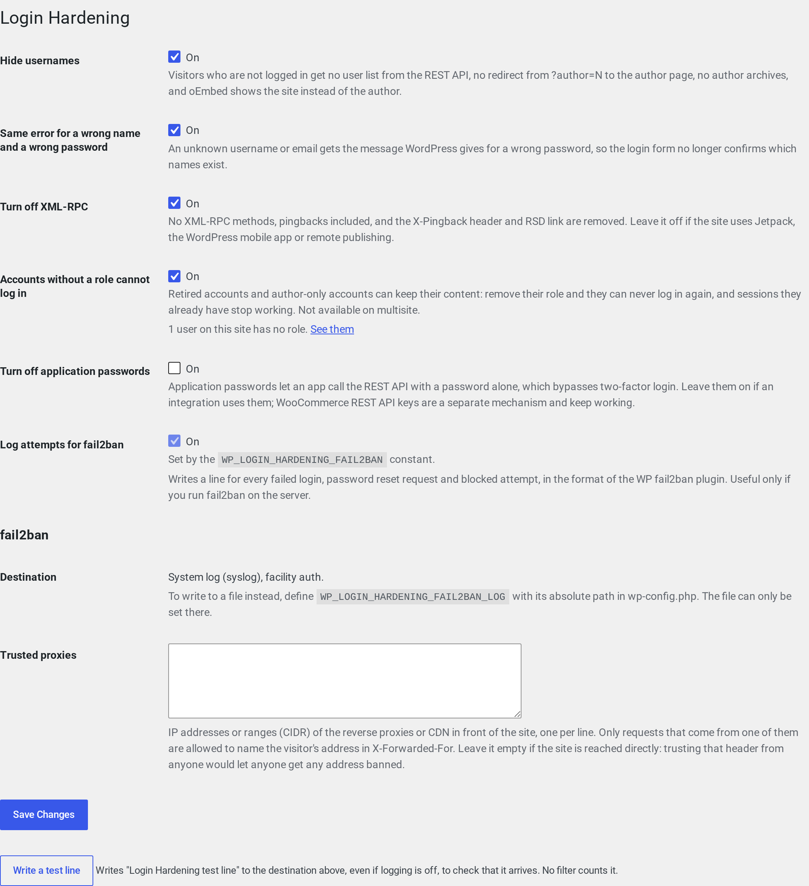

# Login Hardening

A WordPress plugin that takes away what a brute force needs before it starts: the list of real usernames, and a login form that tells a wrong name from a wrong password. It also turns off XML-RPC, locks out accounts that have no role, and, if you run fail2ban on the server, logs every failed or blocked attempt in the format of the WP fail2ban plugin.

Each piece came from something measured on live sites. On one WooCommerce site, 30 days of failed logins (12,694) were aimed at the site's real usernames rather than at `admin` or `test`: they had been read from the open REST users endpoint, so every attempt started with half of the credential already right.



## The blocks

Each block has a checkbox in **Settings → Login Hardening** and a constant that forces it on or off from `wp-config.php` (or from a must-use plugin): a forced block shows a disabled checkbox with the name of the constant.

| Block | Default | Constant |
|---|---|---|
| Hide usernames | on | `WP_LOGIN_HARDENING_ENUMERATION` |
| Same error for a wrong name and a wrong password | on | `WP_LOGIN_HARDENING_LOGIN_ERRORS` |
| Turn off XML-RPC | on | `WP_LOGIN_HARDENING_XMLRPC` |
| Accounts without a role cannot log in | on | `WP_LOGIN_HARDENING_ROLELESS` |
| Turn off application passwords | off | `WP_LOGIN_HARDENING_APP_PASSWORDS` |
| Log attempts for fail2ban | off | `WP_LOGIN_HARDENING_FAIL2BAN` |

```php
// In wp-config.php: XML-RPC stays on (Jetpack), fail2ban logging always on.
define( 'WP_LOGIN_HARDENING_XMLRPC', false );
define( 'WP_LOGIN_HARDENING_FAIL2BAN', true );
```

### Hide usernames

For visitors who are not logged in:

- **REST API**: `/wp/v2/users` answers 401, whatever the case of the route (`/WP/v2/Users` reaches the same handler) and inside `/batch/v1` too. Logged in users keep it: the block editor and many admin plugins call `/wp/v2/users/me` all the time.
- **`?author=N` and author archives** redirect to the home page (302), for real and made-up authors alike. WordPress redirects `?author=1` to `/author/<slug>/`, handing over the slug; and an archive for a real slug against a 404 for a made-up one confirms a guess. The redirect runs on `wp` at priority 1, before SEO plugins that redirect real authors on their own and would otherwise give the two cases different answers.
- **WordPress's own sitemap** no longer lists users (`wp-sitemap-users-1.xml`), which would hand over every author slug.
- **oEmbed** attributes posts to the site instead of their author, as WordPress does for a post with no author. The embed keeps working.

The REST refusal runs last on `rest_pre_dispatch`, because a later callback can overwrite an earlier refusal: ACF 6 returns null there at priority 10, and the endpoint kept answering 200 with the full list.

Turn this block off if the site shows author archives on purpose. Author sitemaps of SEO plugins (Yoast, Rank Math) are theirs to switch off, and WordPress adds a `comment-author-<slug>` class to comments by registered users: neither is covered.

### Same error for a wrong name and a wrong password

WordPress answers "unknown username" for a name that does not exist and "wrong password" for one that does. This block gives an unknown username or email the message WordPress gives for a wrong password, lost password link included, using the core strings so it stays translated. It applies to every form that logs in through WordPress, WooCommerce's included.

If [WP reCaptcha Integration](https://wordpress.org/plugins/wp-recaptcha-integration/) is active, its check also runs for unknown names: it normally runs only for names that exist, which brings the difference back. WordPress checks the password only for names that exist, so an unknown name used to come back measurably faster: the block hashes a throwaway password, which brings the two times roughly level when stored passwords use WordPress's current hashing (bcrypt since 6.8). Users whose password is still stored as an old phpass hash, until their next login, check faster than the throwaway hash, so the difference does not fully disappear on older sites. Under attack, every attempt with an unknown name now costs a hash, as one with a real name already did: expect more CPU than before during a wave.

The login form is not the only place that tells: the lost password forms of WordPress ("There is no account with that username or email address.") and WooCommerce ("Invalid username or email."), and an open registration form ("already registered"), still confirm whether a name exists. This block does not change them.

### Turn off XML-RPC

No XML-RPC methods at all, pingbacks included (`xmlrpc_enabled` alone only removes the methods that need a password), and no `X-Pingback` header or RSD link. The best place to refuse `xmlrpc.php` is the web server, before PHP starts; this block keeps the endpoint closed when that rule gets lost in a migration. Leave it off if the site uses Jetpack, the WordPress mobile app or remote publishing.

### Accounts without a role cannot log in

Remove the role of a retired account, or of an account that only signs articles, and it can never be used again, while its content stays. The right password gets the wrong-password message, and a session opened before the role was removed stops working from its next request: the block acts where WordPress resolves the current user from the auth cookie, whoever issued it.

Check before turning it on: the settings page shows how many users of the site have no role, with a link to them. WooCommerce customers have the Customer role and are not affected; users created by a registration plugin with no role, or with an empty default role, would be locked out. On multisite the block is not available: there a user with no role on one site is normal.

### Turn off application passwords

Application passwords authenticate REST and XML-RPC requests with a password alone, which is a way around two-factor login. Off by default, because integrations use them; WooCommerce REST API keys are a separate mechanism and keep working.

## fail2ban

With the last block on, the plugin writes one line for each of these events, with the client address at the end:

| Event | Line |
|---|---|
| Wrong password for an existing user | `Authentication failure for <user> from <ip>` |
| Unknown user or email | `Authentication attempt for unknown user <user> from <ip>` |
| Login submitted with no name (`wp-login.php`, XML-RPC) | `Empty username from <ip>` |
| WooCommerce login refused before authentication (for example by a captcha) | `WooCommerce login rejected before authentication for <user> from <ip>` |
| Wrong application password | `Application password failure for <user> from <ip>` |
| Lost password form submitted by a visitor, valid user or not (not resets sent by an administrator) | `Password reset form submitted for <user> from <ip>` |
| REST users request, or `?author=N` with pretty permalinks, refused by "Hide usernames" (author archives by slug, and `?author=N` with plain permalinks, are redirected but not logged: they are the byline links crawlers follow) | `Blocked user enumeration attempt from <ip>` |
| XML-RPC request with XML-RPC off | `XML-RPC request blocked from <ip>` |

Logins are counted where WordPress decides them, not from URLs in the access log: WooCommerce processes its login and lost password forms on any URL, so a jail that watches `wp-login.php` and `/my-account/` misses a POST sent to the home page.

**Compatible with WP fail2ban.** The tag (`wordpress(<site host>)`), the facility (auth, notice) and the text of the lines it shares with the WP fail2ban plugin are the same, so its `wordpress-soft` filter recognises the failed login lines and `wordpress-hard` the enumeration and XML-RPC lines. Mind that `wordpress-hard` is usually run with `maxretry = 1`: one REST request for the user list, from anyone, is a ban. The other lines need the filters in this repository.

**Where it writes.** To syslog by default, facility auth: on Debian and Ubuntu with rsyslog that is `/var/log/auth.log`. If PHP cannot reach syslog (a chrooted PHP-FPM pool, for example), define a file:

```php
define( 'WP_LOGIN_HARDENING_FAIL2BAN_LOG', '/home/site/private/wp-login-hardening.log' );
```

The file can only be set with this constant, never from the settings page, and the plugin refuses a path inside the web root or a name that does not end in `.log`: the file holds usernames chosen by whoever attacks the login. It is created readable by its owner and group only (0640), since usernames and addresses are personal data, and it is not rotated: add it to logrotate, with `create 0640 <php user> <group>` so the mode survives rotation. Lines in the file start with an ISO 8601 date with its offset, which fail2ban reads correctly whatever the server's time zone. The **Write a test line** button on the settings page checks that lines arrive.

**Text from the attacker** is cleaned before it is logged: line breaks and control characters become spaces and the name is cut to 60 characters, so a username cannot forge a second line with someone else's address. The address is always at the end of the line, where the filters read it.

**The client address** is `REMOTE_ADDR`. Behind a reverse proxy or a CDN, list its addresses or ranges under **Trusted proxies** (or in `WP_LOGIN_HARDENING_TRUSTED_PROXIES`): for requests from those addresses the client is the last entry of `X-Forwarded-For`, the one the proxy appended; everything to its left was written by the sender and is ignored. If that last entry is missing, invalid or itself a trusted proxy, nothing is logged, rather than a line that would ban the proxy. One layer of proxy is supported: with a CDN in front of a local reverse proxy, have the local proxy restore the real address (for example nginx `real_ip` or Apache `mod_remoteip`) and list only the CDN. If it does not, the plugin logs nothing at all; **Write a test line** says so. The list is empty by default, because trusting that header from anyone lets anyone get any address banned.

This matters behind Cloudflare: a Cloudflare Worker can reach any origin from Cloudflare's own ranges with headers its author chose. Only the entry the proxy appends can be trusted, and a request whose last hop is itself a Cloudflare address is not logged. For a stronger guarantee, restore the address on the web server from Cloudflare's `CF-Connecting-IP`, limited to Cloudflare's ranges (`mod_remoteip`, nginx `real_ip`), and leave the list empty here.

**Filters and jails.** [`fail2ban/filter.d`](fail2ban/filter.d) has three filters (failed logins, lost password, refused probes) and [`fail2ban/jail.d`](fail2ban/jail.d) an example: 30 failed logins or 15 reset requests in an hour, thresholds measured on a WooCommerce shop under attack, and 10 refused probes in an hour as a starting point; a ban of an hour that grows for repeat offenders. Copy them to `/etc/fail2ban/`, set `logpath`, reload, and test with `fail2ban-regex`.

**Behind Cloudflare** the default iptables action blocks nothing, because connections come from Cloudflare: add an action that bans at the edge (fail2ban ships `cloudflare.conf` and `cloudflare-token.conf`) and list Cloudflare's ranges as trusted proxies.

`bantime.increment` in the example jails needs fail2ban 0.11 or later.

The plugin writes nothing to the database for each attempt.

## Limits

- **fail2ban needs root on the server.** On shared hosting the logging block has nothing to feed.
- Wrong application passwords are logged only once an application password has ever been created on the site (or network): until then WordPress does not check them at all.
- A staging copy on the same server, with the logging block on, writes to the same log: test logins there count for the jails of production. Turn logging on in production only, or put your own addresses in `ignoreip`.
- A WooCommerce login or lost password POST with a missing or invalid form nonce, or with no name, is not processed by WooCommerce, so nothing is logged for it. It tries no password.
- Plugins with their own login forms that do not go through `wp_signon()` / `wp_authenticate()` are not covered by the error and logging blocks. Captcha integration is built in for WP reCaptcha Integration only.
- Plugins load after must-use plugins and in alphabetical order. If another plugin resolves the current user while it loads, before this one, the "Accounts without a role" block is too late for that request. Not seen with the 61 plugins of the test site, but possible.
- A session of an account without a role gets a 403 in `/wp-admin/` rather than the login page: WordPress checks the cookie there on its own, then finds a visitor with no permissions.

## Requirements

- WordPress 6.5 or later (tested up to 7.1)
- PHP 7.4 or later
- WooCommerce is optional: its login and lost password forms are covered when it is active.

## Installation

1. Download the zip of the latest [release](https://github.com/bluantinoo/wp-login-hardening/releases), or clone the repository into `wp-content/plugins/wp-login-hardening`.
2. Activate **Login Hardening**. Every block except "Turn off application passwords" and "Log attempts for fail2ban" is on from activation.
3. Check **Settings → Login Hardening**, especially the number of users without a role.

Deleting the plugin removes its settings. A log file set with the constant is left alone.

## Moving from WP fail2ban

Deactivate WP fail2ban, turn on the logging block here, keep your jails: the failed login lines are the same. Check the `wordpress-hard` jail first (see above). Add the filters of this repository to also catch WooCommerce logins refused by a captcha, lost password floods and wrong application passwords.

## Updates

The plugin is not on wordpress.org: it updates itself from the [GitHub releases](https://github.com/bluantinoo/wp-login-hardening/releases) of this repository, through the bundled [Plugin Update Checker](https://github.com/YahnisElsts/plugin-update-checker) library (MIT). New versions show up in **Dashboard → Updates** and in `wp plugin update`, like any other plugin. The `Update URI` header tells WordPress not to look for this slug on wordpress.org, so a different plugin published there under the same name can never be offered as an update.

Only the zip attached to a release is installed. The site asks the GitHub API for the latest release about every 12 hours. GitHub sees what WordPress sends with every outgoing request: the server's IP address, and the WordPress version and site URL in the User-Agent.

Whoever can publish a release on this repository can ship code to every site that runs the plugin, which is true of any update channel. Releases are built by the workflow in `.github/workflows/release.yml` from a version tag on `main`.

## License

GPL-2.0-or-later. See [LICENSE](LICENSE).

## Author

Diego Vagnoli, [diegovagnoli.it](https://diegovagnoli.it)
